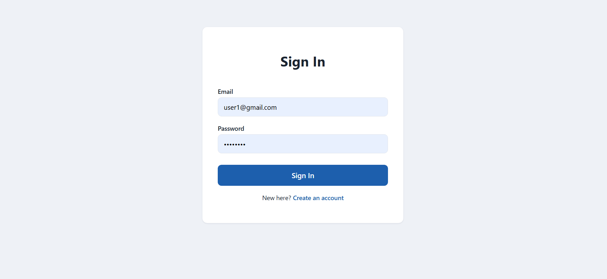
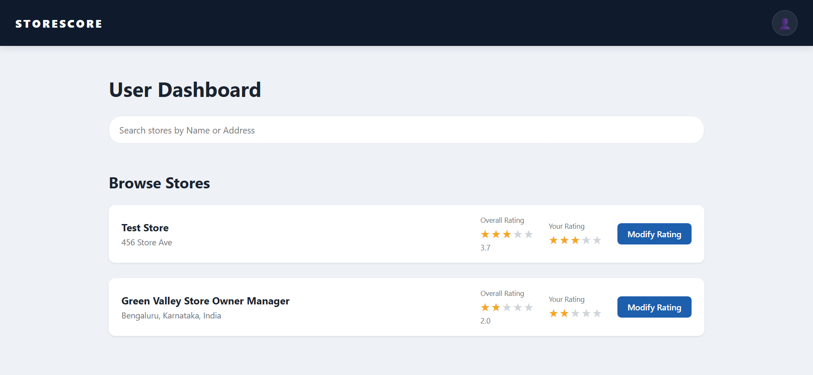
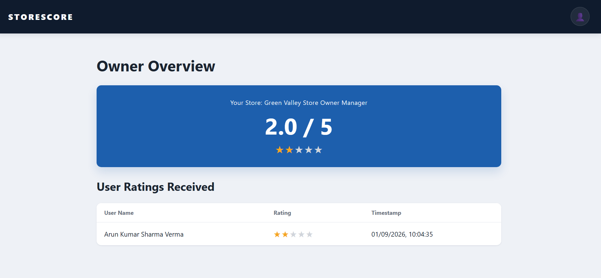
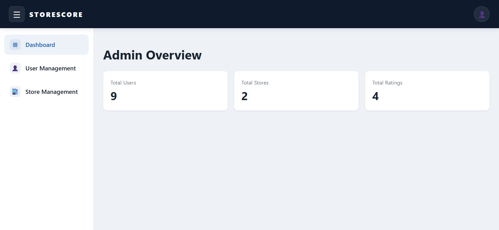

# 🏪 Store Rating App

A full-stack web application for managing **stores, users, and ratings** with role-based access for **Administrators, Store Owners, and Regular Users**.

🔗 **GitHub Repository:** https://github.com/Shital-3/store-rating-app
🚀 **Live Demo:** https://store-rating-app-rho-one.vercel.app

---

## 📌 Overview

The **Store Rating App** provides a centralized platform where users can discover stores and submit ratings, while store owners can monitor their store performance and administrators can manage the entire platform.

The application implements **JWT-based authentication**, **role-based authorization**, and a **MySQL database** for secure and structured data management.

---

## ✨ Features

### 👨‍💼 Admin

* 📊 Dashboard with platform statistics
* 👥 Create and manage users
* 🏪 Manage stores
* ⭐ Monitor submitted ratings
* 🔐 Role-based access control
* 👤 View user and store information

### 👤 User

* 🔍 Search stores by name or address
* 🏪 Browse available stores
* ⭐ Submit ratings for stores
* 📈 View store ratings
* 📱 Responsive dashboard experience

### 🏪 Store Owner

* 🏪 View assigned store information
* ⭐ View average store rating
* 📊 Monitor customer ratings
* 👥 View users who rated the store
* 📈 Track store performance

---

## 🔐 Authentication & Authorization

The application uses **JWT (JSON Web Tokens)** for authentication.

### Authentication Flow

```text
User Login
    ↓
Email + Password
    ↓
Backend Authentication
    ↓
JWT Token Generated
    ↓
Token Stored on Client
    ↓
Protected API Requests
    ↓
Role Verification
    ↓
Dashboard Access
```

Different roles are redirected to their respective dashboards:

```text
Admin  → Admin Dashboard
User   → User Dashboard
Owner  → Owner Dashboard
```

---

## 🛠️ Tech Stack

### Frontend

* React 19
* Vite
* React Router DOM
* Axios
* CSS Modules
* Custom CSS

### Backend

* Node.js
* Express.js
* JWT
* bcrypt
* REST APIs

### Database

* MySQL

### Deployment

* Vercel — Frontend

---

## 📂 Project Structure

```text
store-rating-app/
│
├── backend/
│   ├── src/
│   │   ├── controllers/
│   │   ├── middleware/
│   │   ├── routes/
│   │   ├── models/
│   │   └── ...
│   │
│   ├── package.json
│   └── .env
│
├── frontend/
│   ├── src/
│   │   ├── components/
│   │   ├── pages/
│   │   ├── context/
│   │   ├── services/
│   │   └── ...
│   │
│   ├── package.json
│   ├── vite.config.js
│   └── index.html
│
├── screenshots/
│   ├── login.png
│   ├── user-dashboard.png
│   ├── owner-dashboard.png
│   └── admin-dashboard.png
│
├── README.md
└── .gitignore
```

---

## ⚙️ Prerequisites

Make sure the following are installed on your system:

* **Node.js v18+**
* **npm**
* **MySQL**
* **Git**

Check your versions:

```bash
node -v
npm -v
mysql --version
git --version
```

---

## 🗄️ Database Setup

Create the MySQL database:

```sql
CREATE DATABASE store_rating_db;
```

Then import or execute the SQL schema provided with the project to create the required tables.

---

## 🔑 Environment Variables

Create a `.env` file inside the `backend` folder.

```env
DB_HOST=localhost
DB_USER=root
DB_PASSWORD=your_mysql_password
DB_NAME=store_rating_db
DB_PORT=3306

JWT_SECRET=your_secure_secret_key

PORT=5000
```

> ⚠️ Never commit your `.env` file to GitHub.

Add it to `.gitignore`:

```text
.env
node_modules/
```

---

## 📦 Installation

### 1. Clone the Repository

```bash
git clone https://github.com/Shital-3/store-rating-app.git
```

Navigate into the project:

```bash
cd store-rating-app
```

---

### 2. Install Backend Dependencies

```bash
cd backend
npm install
```

---

### 3. Install Frontend Dependencies

Open another terminal:

```bash
cd frontend
npm install
```

---

## ▶️ Running the Application

### Start Backend

From the `backend` directory:

```bash
npm run dev
```

Backend server:

```text
http://localhost:5000
```

---

### Start Frontend

From the `frontend` directory:

```bash
npm run dev
```

Frontend application:

```text
http://localhost:5173
```

Open the frontend URL in your browser.

---

## 👤 Default Admin Account

A seed administrator account is provided for testing.

```text
Email: admin@gmail.com
Password: Admin@123
```

> ⚠️ Change the default credentials before using the application in a production environment.

---

## 🖥️ Application Screenshots

### 🔐 Login Page

Secure login interface for Admin, User, and Owner accounts.



---

### 👤 User Dashboard

Users can search stores, view ratings, and submit their own ratings.



---

### 🏪 Owner Dashboard

Store owners can monitor their assigned store and view customer ratings.



---

### 🎯 Admin Dashboard

Administrators can manage users and stores while monitoring platform statistics.



---

## 🔄 Application Workflow

```text
                    ┌───────────────┐
                    │     Login     │
                    └───────┬───────┘
                            │
                       Authentication
                            │
                    ┌───────▼───────┐
                    │   JWT Token   │
                    └───────┬───────┘
                            │
                    Role Verification
                            │
          ┌─────────────────┼─────────────────┐
          │                 │                 │
          ▼                 ▼                 ▼
       Admin              User              Owner
          │                 │                 │
          ▼                 ▼                 ▼
     Admin Panel       Store Search      Owner Panel
          │                 │                 │
     Manage Users      Submit Rating     View Ratings
     Manage Stores     View Stores       Average Rating
     View Statistics                     Customer Data
```

---

## 🔒 Security

The application implements several security practices:

* JWT-based authentication
* Password hashing using bcrypt
* Protected API routes
* Role-based authorization
* Environment variables for sensitive configuration
* `.env` excluded from Git

---

## 📊 Main Modules

| Module         | Description                           |
| -------------- | ------------------------------------- |
| Authentication | Login and JWT-based authentication    |
| Admin          | User, store and platform management   |
| User           | Store search and rating submission    |
| Owner          | Store performance and rating analysis |
| Database       | MySQL data persistence                |
| Authorization  | Role-based route protection           |

---

## 🚀 Production Build

### Frontend

```bash
cd frontend
npm run build
```

The production build will be generated in:

```text
frontend/dist/
```

### Backend

```bash
cd backend
npm start
```

---

## 🔗 Project Links

### 📂 GitHub

https://github.com/Shital-3/store-rating-app

### 🚀 Live Demo

https://store-rating-app-rho-one.vercel.app

---

## 👨‍💻 Author

**Shital Nirmal**

Computer Engineering Student | Frontend & Full-Stack Developer

🔗 GitHub: https://github.com/Shital-3

---

## 📄 License

This project is created for **educational and demonstration purposes**.
